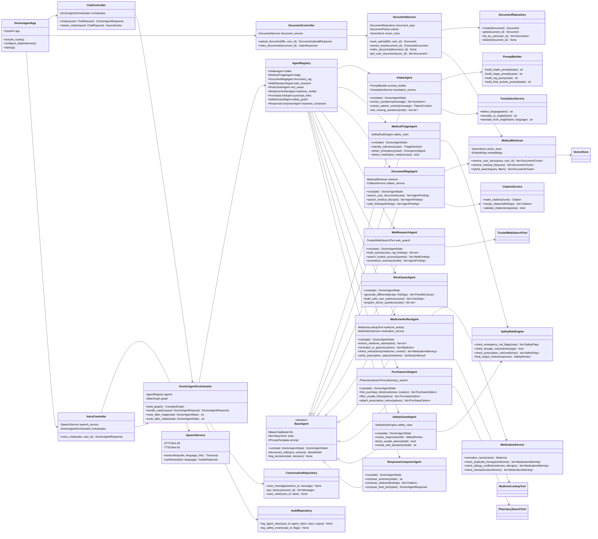
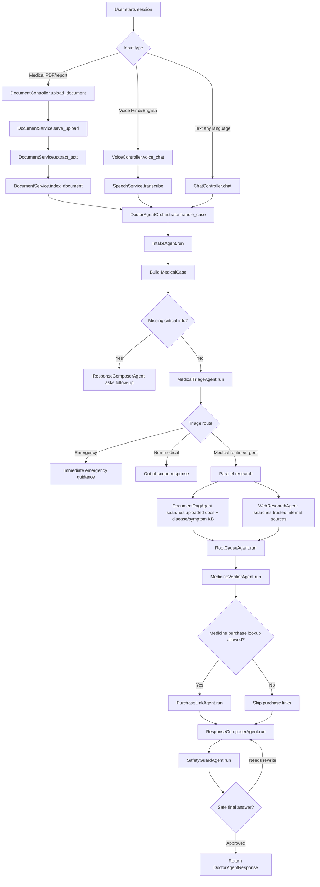
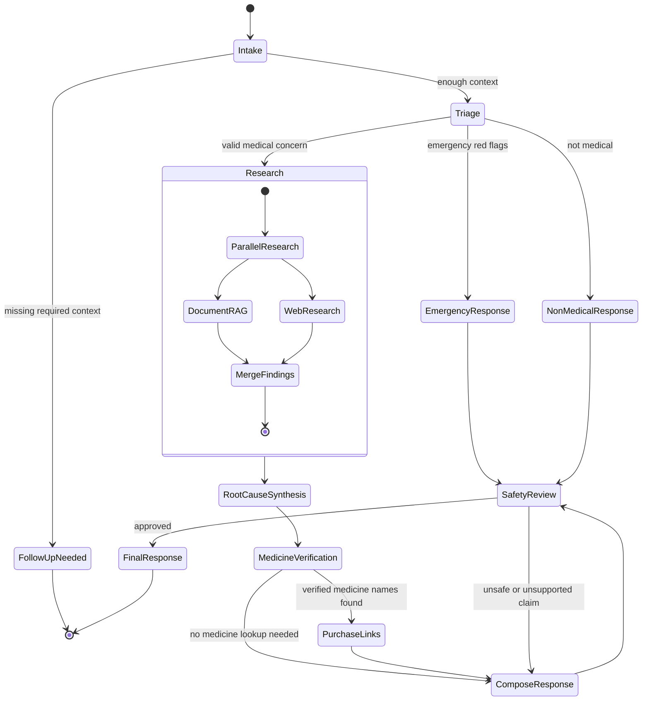
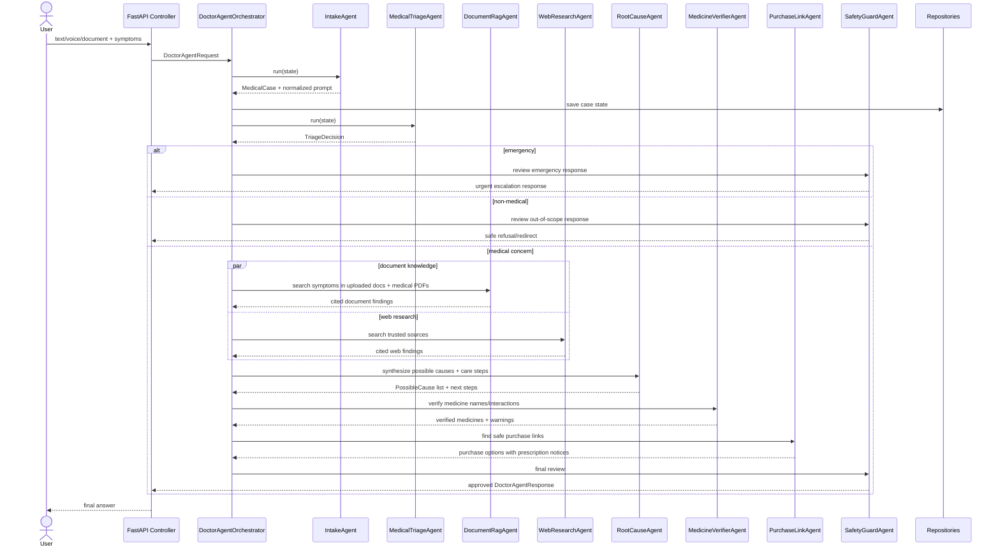
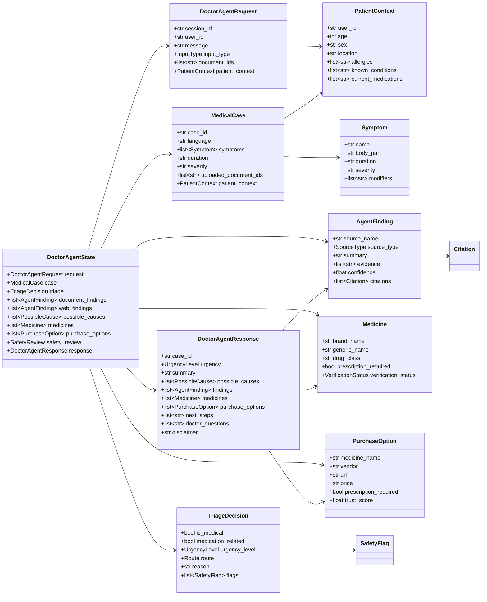
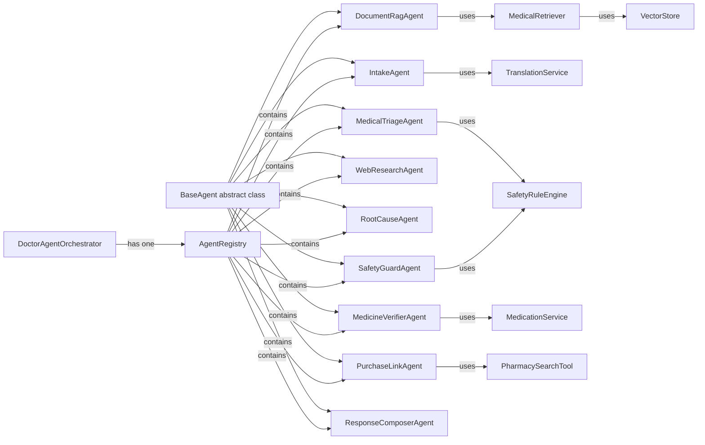
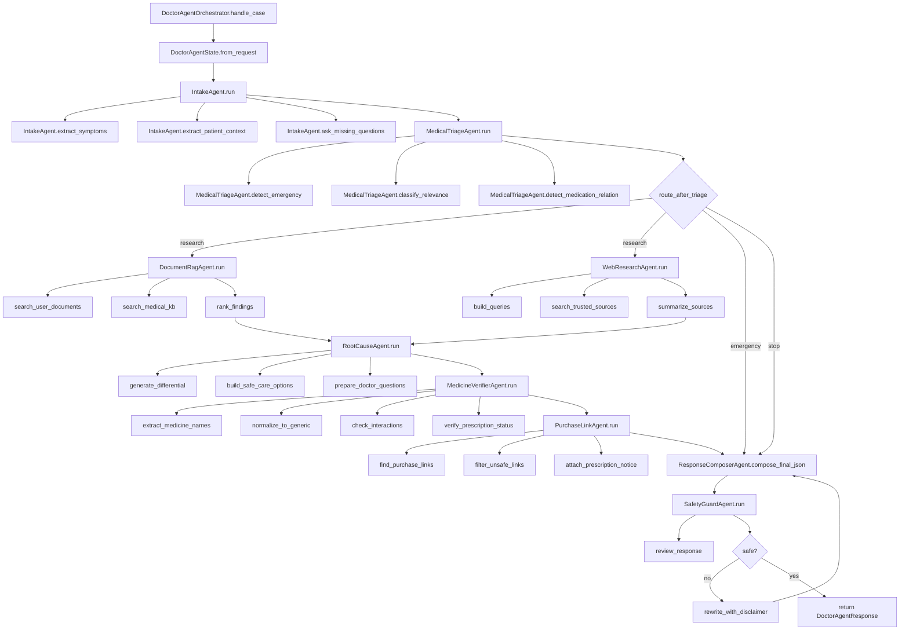
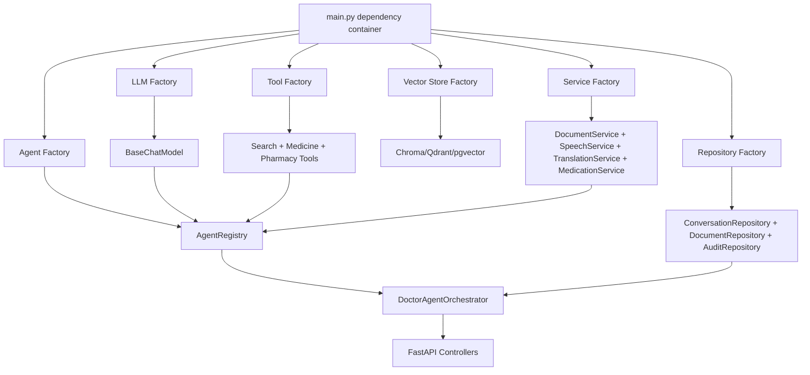

# Doctor AI Agent - OOP + LangChain Diagram Canvas

This canvas describes the system as Python classes, methods, inheritance, and runtime connections.

## 1. Complete Class Diagram



## 2. Main Runtime Flow



## 3. LangGraph State Machine



## 4. Sequence Diagram - One User Query



## 5. Data Classes And Relationships



## 6. Inheritance And Composition Rules



## 7. Method-Level Call Flow



## 8. Python Class Skeleton

```python
from abc import ABC, abstractmethod
from typing import Literal
from pydantic import BaseModel, Field


class PatientContext(BaseModel):
    user_id: str
    age: int | None = None
    sex: str | None = None
    location: str | None = None
    allergies: list[str] = Field(default_factory=list)
    known_conditions: list[str] = Field(default_factory=list)
    current_medications: list[str] = Field(default_factory=list)


class Symptom(BaseModel):
    name: str
    body_part: str | None = None
    duration: str | None = None
    severity: str | None = None
    modifiers: list[str] = Field(default_factory=list)


class MedicalCase(BaseModel):
    case_id: str
    language: str
    symptoms: list[Symptom]
    duration: str | None = None
    severity: str | None = None
    uploaded_document_ids: list[str] = Field(default_factory=list)
    patient_context: PatientContext


class TriageDecision(BaseModel):
    is_medical: bool
    medication_related: bool
    urgency_level: Literal["emergency", "urgent", "routine", "non_medical"]
    route: Literal["emergency", "research", "ask_followup", "stop"]
    reason: str


class DoctorAgentState(BaseModel):
    request: "DoctorAgentRequest"
    case: MedicalCase | None = None
    triage: TriageDecision | None = None
    document_findings: list["AgentFinding"] = Field(default_factory=list)
    web_findings: list["AgentFinding"] = Field(default_factory=list)
    medicines: list["Medicine"] = Field(default_factory=list)
    purchase_options: list["PurchaseOption"] = Field(default_factory=list)
    response: "DoctorAgentResponse | None" = None


class BaseAgent(ABC):
    def __init__(self, llm, tools=None):
        self.llm = llm
        self.tools = tools or []

    @abstractmethod
    async def run(self, state: DoctorAgentState) -> DoctorAgentState:
        pass

    async def structured_call(self, prompt: str, schema: type[BaseModel]) -> BaseModel:
        chain = self.llm.with_structured_output(schema)
        return await chain.ainvoke(prompt)


class IntakeAgent(BaseAgent):
    def __init__(self, llm, prompt_builder, translation_service):
        super().__init__(llm)
        self.prompt_builder = prompt_builder
        self.translation_service = translation_service

    async def run(self, state: DoctorAgentState) -> DoctorAgentState:
        prompt = self.prompt_builder.build_intake_prompt(state.request)
        state.case = await self.structured_call(prompt, MedicalCase)
        return state


class MedicalTriageAgent(BaseAgent):
    def __init__(self, llm, safety_rules):
        super().__init__(llm)
        self.safety_rules = safety_rules

    async def run(self, state: DoctorAgentState) -> DoctorAgentState:
        emergency_flags = self.safety_rules.check_emergency_red_flags(state.case)
        if emergency_flags:
            state.triage = TriageDecision(
                is_medical=True,
                medication_related=False,
                urgency_level="emergency",
                route="emergency",
                reason="Emergency red flags detected.",
            )
            return state

        prompt = f"Classify this medical case: {state.case.model_dump_json()}"
        state.triage = await self.structured_call(prompt, TriageDecision)
        return state


class DoctorAgentOrchestrator:
    def __init__(self, agents):
        self.agents = agents
        self.graph = self.build_graph()

    def build_graph(self):
        from langgraph.graph import StateGraph, END

        graph = StateGraph(DoctorAgentState)
        graph.add_node("intake", self.agents.intake.run)
        graph.add_node("triage", self.agents.triage.run)
        graph.add_node("document_rag", self.agents.document_rag.run)
        graph.add_node("web_research", self.agents.web_research.run)
        graph.add_node("root_cause", self.agents.root_cause.run)
        graph.add_node("medicine", self.agents.medicine_verifier.run)
        graph.add_node("purchase_links", self.agents.purchase_links.run)
        graph.add_node("response", self.agents.response_composer.run)
        graph.add_node("safety", self.agents.safety_guard.run)

        graph.set_entry_point("intake")
        graph.add_edge("intake", "triage")
        graph.add_conditional_edges(
            "triage",
            self.route_after_triage,
            {
                "emergency": "response",
                "stop": "response",
                "research": "document_rag",
            },
        )
        graph.add_edge("document_rag", "web_research")
        graph.add_edge("web_research", "root_cause")
        graph.add_edge("root_cause", "medicine")
        graph.add_edge("medicine", "purchase_links")
        graph.add_edge("purchase_links", "response")
        graph.add_edge("response", "safety")
        graph.add_edge("safety", END)
        return graph.compile()

    def route_after_triage(self, state: DoctorAgentState) -> str:
        return state.triage.route

    async def handle_case(self, request):
        state = DoctorAgentState(request=request)
        final_state = await self.graph.ainvoke(state)
        return final_state.response
```

## 9. Recommended Connections In Code



## 10. Build Order

```mermaid
flowchart LR
    A[Define Pydantic domain models] --> B[Create BaseAgent]
    B --> C[Build IntakeAgent]
    C --> D[Build MedicalTriageAgent]
    D --> E[Create LangGraph orchestrator]
    E --> F[Add DocumentService + RAG]
    F --> G[Add WebResearchAgent]
    G --> H[Add RootCauseAgent]
    H --> I[Add MedicineVerifierAgent]
    I --> J[Add PurchaseLinkAgent]
    J --> K[Add SafetyGuardAgent]
    K --> L[Expose FastAPI endpoints]
    L --> M[Write tests and evals]
```


